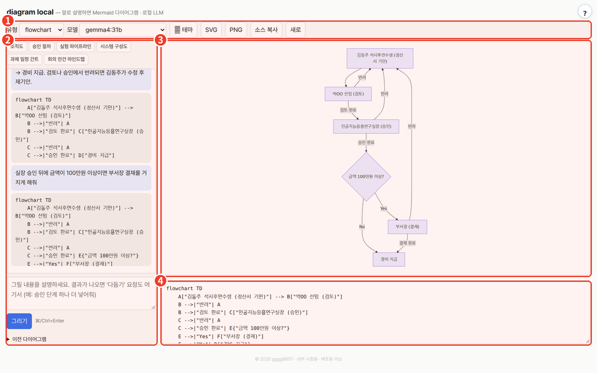

# diagram-local — 말로 설명하면 다이어그램 (Mermaid · 로컬 LLM)

업무 흐름이나 구조를 한국어로 설명하면 로컬 LLM이 Mermaid 소스를 쓰고, 브라우저가 바로 그림으로 그립니다. 소스를 직접 고치거나 대화로 다듬은 뒤 SVG·PNG로 내려받습니다.

> ⚠️ 연구·내부 시험용 프로토타입입니다(배포·상업 서비스용 아님). 제3자 구성요소의 라이선스는 THIRD_PARTY_NOTICES.md 를 확인하세요.



## 무엇을 하나

- 순서도·시퀀스·클래스·ER·상태도·간트·마인드맵·타임라인·파이 9종(또는 자동)을 설명 한 줄로 그립니다("결재 절차 그려줘").
- "단계 하나 더 넣어줘"처럼 대화로 다듬고, 파싱 오류가 나면 LLM에게 한 번 자동으로 고치게 합니다.
- 파이썬 표준 라이브러리만 쓰고 mermaid.js(MIT)를 폴더에 동봉해 CDN·외부 통신이 없습니다. 폴더 복사만으로 폐쇄망에 배포합니다.
- 보고서 삽도·시스템 구성도·과제 일정표 초안을 빠르게 뽑는 용도입니다.

## 사용 방법

번호는 위 화면의 상자 번호입니다.

1. **유형·테마** — 다이어그램 유형(또는 자동)과 밝은·어두운 테마를 고릅니다(포털에서 클래식 밝게 외의 화면 테마를 쓰면 🌙 단추는 숨고 포털 테마를 따릅니다). 처음이면 왼쪽 예시 버튼(조직도·승인 절차·실험 파이프라인…)을 눌러 보세요.
2. **설명·다듬기** — 그릴 내용을 적고 **그리기**(Ctrl+Enter). 결과가 나오면 같은 칸에 "DB를 원통으로", "라벨 영어로" 같은 변경을 요청합니다.
3. **미리보기** — Mermaid 소스를 그림으로 확인합니다.
4. **소스 편집** — 코드를 직접 고치면 즉시 반영됩니다. 파싱 오류가 나면 LLM 수정 요청을 한 번 시도합니다.

끝나면 위쪽 **SVG / PNG** 로 저장하거나 **소스 복사**로 Mermaid 소스를 가져갑니다.

## 예시

실제로 실행한 입력과 결과입니다(gemma4:31b, 2026-10-12).

- **입력**: `학회 출장비 정산 결재 절차: 김동주 석사후연수생이 정산서 기안 → 박OO 선임 검토 → 인공지능응용연구실장 승인 → 경비 지급. 검토나 승인에서 반려되면 김동주가 수정 후 재기안.`
- **결과**: 기안 → 검토 → 실장 승인 → 경비 지급 순서도. 검토·승인의 반려 연결이 기안으로 돌아갑니다.
- **다듬기**: 같은 칸에 `실장 승인 뒤에 금액이 100만원 이상이면 부서장 결재를 거치게 해줘` → 금액 조건 분기와 부서장 결재 단계가 추가된 순서도(위 화면 ②·③·④).

결재 단계와 금액 기준은 예시이며, 실제 기관 결재 규정을 검증한 결과가 아닙니다.

## 설치·실행

```bash
bash setup.sh                 # OS 감지 → Python → LLM 서버 탐색(없으면 Ollama 설치) → selftest → http://localhost:8768
bash setup.sh stop
python3 app.py                # 수동 실행
python3 app.py --cli "시료 채취 → 전처리 → 측정 → 보고서 순서" flowchart   # Mermaid 소스를 stdout에
python3 selftest.py           # LLM 없이 검증
```

| 환경변수 | 기본 | 설명 |
|---|---|---|
| `LLM_API` | `ollama` | `ollama` 또는 `openai`(vLLM·LM Studio·llama.cpp) |
| `LLM_BASE_URL` | `http://localhost:11434` / `http://localhost:8000/v1` | 서버 주소 |
| `LLM_MODEL` | `qwen3:8b` | UI에서 변경 가능. 포털로 띄우면 로컬 Ollama `gemma4:31b` |
| `LLM_API_KEY` | (없음) | OpenAI 호환 서버 키 |
| `NUM_CTX` | `16384` | Ollama 컨텍스트 |
| `PORT` | `8768` | |
| `WORKSPACE` | `./_workspace` | 실행 기록 저장 폴더 (포털이 도구별 데이터 폴더로 지정) |
| `BIND` | (모든 인터페이스) | 듣는 주소. 포털은 `127.0.0.1` 로 띄워 포털을 거쳐서만 접근 |

## 구조

흐름: 설명 → `goal-prompt.md`(출력 계약: Mermaid만, 한글 라벨은 따옴표, 노드 id 영문) → LLM 1콜 → 서버 1차 검사(선언·괄호·따옴표) → 브라우저 mermaid 렌더 → 파싱 오류면 `/api/repair` 로 LLM 수정 1회.
다듬기 요청은 현재 소스를 함께 보내 전체 소스를 다시 받습니다. 결과는 `$WORKSPACE/<id>.json`(입력·대화·Mermaid 소스).
기록은 사용자별로 따로 저장합니다(포털 접속자 기준, 포털이 넘기는 `X-Agent-User` 헤더 → `$WORKSPACE/u/<사용자>/`). 서버 주인(헤더 없음·`owner`)은 `$WORKSPACE` 그대로라 예전 기록도 보입니다.

## 폐쇄망

이 폴더를 통째로 복사하면 끝 (`static/mermaid.min.js` 포함). 외부 통신은 LLM 서버 주소뿐.

## 출처·감사 (Credits)

- 동봉: [mermaid](https://github.com/mermaid-js/mermaid) 11.17.2 (`static/mermaid.min.js`, MIT, Copyright (c) 2014-2022 Knut Sveidqvist)
- `setup.sh` 는 Ollama 에 모델이 하나도 없을 때만 `qwen3:8b` ([Apache-2.0](https://huggingface.co/Qwen/Qwen3-8B)) 를 내려받습니다.
- **LLM 실행** — OpenAI 호환 API 로 호출합니다(모델 가중치는 동봉하지 않음). 기본 배포는 [Ollama](https://github.com/ollama/ollama) (MIT) 위의 Google [Gemma 4](https://ai.google.dev/gemma) `gemma4:31b` ([Apache-2.0](https://ai.google.dev/gemma/docs/gemma_4_license)).
- 이 도구는 [agent-page-portal](https://github.com/gggg8657/agent-page-portal) 에 연결해 쓰도록 만들었습니다(단독 실행도 됨).

버전·라이선스·상업 이용 여부 전체 표는 [`THIRD_PARTY_NOTICES.md`](THIRD_PARTY_NOTICES.md), 저작권 표기는 `NOTICE` 를 보세요.

## 라이선스

MIT License — Copyright (c) 2026 DongJu Kim (gggg8657). `LICENSE` 참고. 제3자 구성요소는 각자의 라이선스를 따릅니다.

## 만든 사람

DongJu Kim (gggg8657) — 설계·구현
